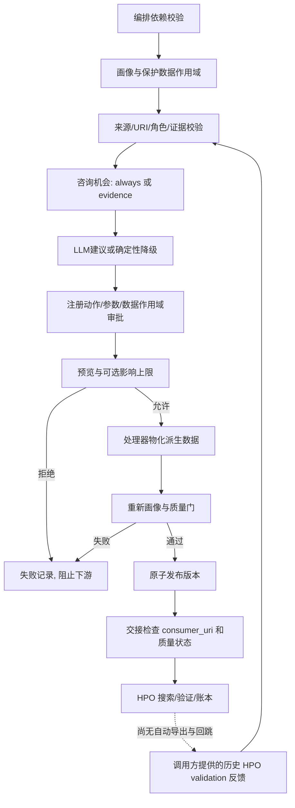

# 数据处理智能体闭环复核

结论：当前适合作为“有界建议 + 确定性处理 + 质量门”的数据准备模块；质量闭环已接通，训练效果闭环尚未自动接通。增加智能体数量之前，应先完善证据的版本绑定和有限试验归因。

## 本轮实际路径

## 闭环逐项验收

|环节|代码和证据|当前判断|
|---|---|---|
|发现问题→建议|workflow._inspect/_advise、profile_coverage、feedback.py；工作流/提示测试|接通，但画像按上限探测，不能证明全量健康|
|反馈→决策|请求的 hpo_feedback 进入 workflow 和提示；跨数据 URI/final_test/无样本拒绝测试|接通外部输入路径；尚无自动 HPO 导出器，URI 不是不可变内容身份|
|建议→可执行动作|service.build_processing_plan 的注册/参数/受保护字段约束；影响限制在 execute 前|接通；LLM 无法改 HPO 参数或越过固定质量门|
|处理→质量反馈|派生数据重新画像、DefaultQualityGate、发布与 handoff|接通；兼容旧审计动作，变更受保护作用域拒绝|
|失败→记录/停止|编排依赖失败阻断、工作流异常落盘、版本替换故障测试|接通；不是自动修复循环|
|数据变化→训练效果→保留/回滚|无自动配对数据版本试验和采纳状态机|未闭环，不能声称清洗提高 EER|
|中断→续跑数据阶段|数据 workflow 无阶段持久化恢复日志，版本发布是原子提交|未闭环；HPO 的恢复机制不能直接代表数据处理恢复|
|成本→数据动作选择|HPO 有资源账本；数据阶段目前主要记录 duration/impact|部分闭合；CPU/I/O、LLM 与整链成本尚未统一|

验收证据在 validation/verified_test_inventory.json：含 real WAV 预览拒绝、发布故障、传递链和编排失败传播。没有调用真实 LLM 来证明决策质量，也没有以 fake runner 宣称识别性能提升。

## 优先修补的语义边界

1. 数据身份：反馈增加 dataset_version_id、训练清单和验证配对摘要、模型/训练协议签名。只在摘要匹配时使用；历史记录缺字段标为未知。当前 URI 相同但内容被替换仍可能引入过期反馈，这是本轮明确保留的限制。
2. 画像置信度：当前截取文件和信号的前 N 个样本，目录顺序可能有偏；probe_limited 只是达到上限的指示，不能解释为精确遗漏率。下一版应按说话人/时长/录音域分层、固定种子采样，记录分层数量与未知范围。
3. 影响语义：当前 cap 是每操作、基于完整预览的估算。多个小过滤可能累积成大删除；manifest 处理器没有 scan_complete 证明时，新限制会拒绝它。后续增加累计保留人数/时长、最差复制空间估计和实际空间停止机制，不能声称当前 cap 是全局硬配额。
4. 续训与数据变更：只要清单或预处理改变，就不满足现有“同数据协议续训”。清洗前后对照应从头训练，不能把续训带来的额外训练量误当成数据改善。
5. 发布成功≠可消费：派生产物可能仅为清单报告，consumer_ready=false 时 handoff 必须继续阻断训练。
6. 数据咨询失败当前会降级并记录，下一次工作流可以重新咨询；尚无数据咨询的持久机会 ID/重放去重。本轮未将 HPO 咨询状态机推广到所有智能体。

## 研究结论与项目推断

[DataPerf](https://www.dataperf.org/)及其[基准论文](https://arxiv.org/abs/2207.10062)将数据集与数据中心算法作为可测对象。对本项目的推断是：应固定模型与训练预算测试数据选择/清洗贡献，单报质量规则通过率不够。

[ActiveClean 论文](https://arxiv.org/abs/1601.03797)研究渐进清洗与模型更新，理论条件包括凸损失；不能直接声称对 ECAPA 非凸训练有同样保证。本项目可借鉴“小批量清洗→检查影响→有限验证”，而不是每次改一份数据就跑 12 小时全量训练。

[Confident Learning 原论文](https://arxiv.org/abs/1911.00068)给出标签错误估计与候选排序方法。项目可探索用独立折预测/嵌入一致性生成疑似身份错标候选，先人工抽检或降权；低置信度也可能是困难但有价值的样本，不应无验证删除。此方向未实现。

建议顺序：先补版本和分层证据，再加一次一个变量的低成本数据试验，最后才增加独立诊断/评估智能体。新增决策点要有可改变的对象、可检验假设、停止条件和反事实对照。
